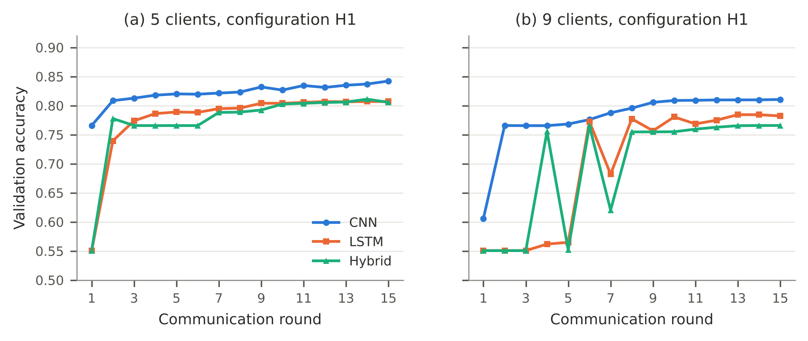
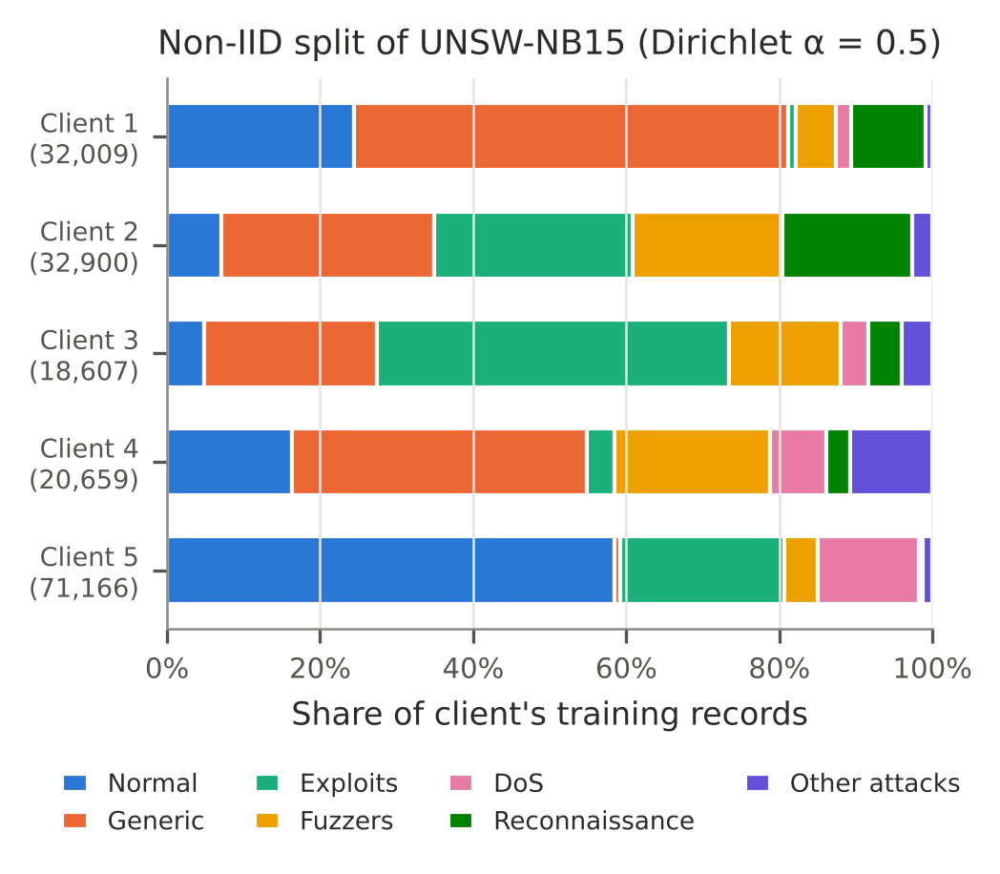

# Federated Learning for Network Intrusion Detection on UNSW-NB15

Code and results for the paper **"AI-Based Network Intrusion Detection Using Federated Learning and Deep Learning"** by Muhammad Awais Raza and Warisha Malik (Sir Syed CASE Institute of Technology, Islamabad).

This repository trains CNN, LSTM and hybrid CNN–LSTM intrusion detectors with **Federated Averaging (FedAvg)** on **non-IID clients**, using the **official UNSW-NB15 training and testing partitions**. Everything runs in one Google Colab notebook.

## Key results

Final-round results on the official UNSW-NB15 test set (82,332 records), 5 clients:

| Configuration | Model | Accuracy | Precision | Recall | F1-score | ROC-AUC |
|---|---|---|---|---|---|---|
| H1 (batch 500, 1 local epoch, 15 rounds) | CNN | 84.2% | 0.781 | 0.991 | 0.874 | 0.976 |
| H1 | LSTM | 80.7% | 0.742 | 0.995 | 0.850 | 0.935 |
| H1 | Hybrid CNN–LSTM | 80.6% | 0.740 | 0.998 | 0.850 | 0.934 |
| H2 (batch 128, 5 local epochs, 14 rounds) | CNN | 87.3% | 0.820 | 0.986 | 0.895 | 0.983 |
| H2 | LSTM | 84.6% | 0.786 | 0.990 | 0.876 | 0.980 |
| **H2** | **Hybrid CNN–LSTM** | **88.6%** | **0.837** | 0.984 | **0.905** | **0.984** |

Main findings:
- More local training per round (H2) improved every model; with it, the hybrid CNN–LSTM gave the best result.
- Splitting the same data across 9 clients instead of 5 reduced accuracy for every model and made the recurrent models unstable.
- Recall stayed above 0.98 everywhere; **precision (false alarms) is the main weakness** of FedAvg-based intrusion detection in this setting.

The full results (including 9 clients and configuration H3) are in [`summary.csv`](summary.csv), and per-round values for every experiment are in the `history_*.csv` files.



## Method

| Step | Details |
|---|---|
| Data | UNSW-NB15 official partitions: 175,341 training and 82,332 testing records. The notebook trains on the larger file even if the two file names are swapped, as they are in many copies of the dataset. |
| Preprocessing | Drop `id`; label-encode `proto`, `service`, `state`; MinMax scaling fitted on the training set only; 42 features reshaped to `(42, 1)` |
| Clients | Non-IID Dirichlet split over attack categories (α = 0.5), 5 or 9 clients |
| Federated training | FedAvg weighted by client size; Adam (lr = 1e-3), binary cross-entropy, threshold 0.5 |
| Models | CNN (72k parameters), LSTM (63k), hybrid CNN–LSTM (89k) |
| Evaluation | Accuracy, precision, recall, F1-score, ROC-AUC and loss on the full official test set after every round |



## How to reproduce

1. Open [`FL_NIDS_UNSW_NB15.ipynb`](FL_NIDS_UNSW_NB15.ipynb) in [Google Colab](https://colab.research.google.com) (*File → Upload notebook*).
2. Select *Runtime → Change runtime type → T4 GPU*.
3. Select *Runtime → Run all*.
   - The notebook downloads UNSW-NB15 from Kaggle automatically. If that fails, it asks you to upload `UNSW_NB15_training-set.csv` and `UNSW_NB15_testing-set.csv`.
   - Results are saved to Google Drive after every experiment. If Colab disconnects, *Run all* again and finished experiments are loaded instead of retrained.
4. A full run takes roughly 1–3 hours on a T4 GPU. Set `QUICK_TEST = True` in the first cell for a 5-minute check.

All settings (number of clients, Dirichlet α, batch sizes, local epochs, rounds, learning rate, seed) are in the first cell.

## Repository contents

| Path | Contents |
|---|---|
| `FL_NIDS_UNSW_NB15.ipynb` | Complete pipeline: data, partitioning, models, FedAvg, experiments, figures |
| `summary.csv` | Final-round metrics and mean time per round for every experiment |
| `history_*.csv` | Per-round training and test metrics for each experiment (values rounded to 4 decimals) |
| `fig_*.png` | Figures used in the paper |
| `requirements.txt` | Python packages (all pre-installed on Colab) |

## Citation

If you use this code, please cite:

```bibtex
@misc{raza2026flnids,
  title  = {AI-Based Network Intrusion Detection Using Federated Learning and Deep Learning},
  author = {Raza, Muhammad Awais and Malik, Warisha},
  year   = {2026},
  note   = {Preprint},
  url    = {https://github.com/AwaisRazaKundi/fl-nids-unsw-nb15}
}
```

## License

MIT License, see [`LICENSE`](LICENSE). The UNSW-NB15 dataset is the work of the Cyber Range Lab of the Australian Centre for Cyber Security (ACCS) and is subject to its own terms of use (Moustafa and Slay, MilCIS 2015).

## Contact

Muhammad Awais Raza · awais1282@gmail.com
